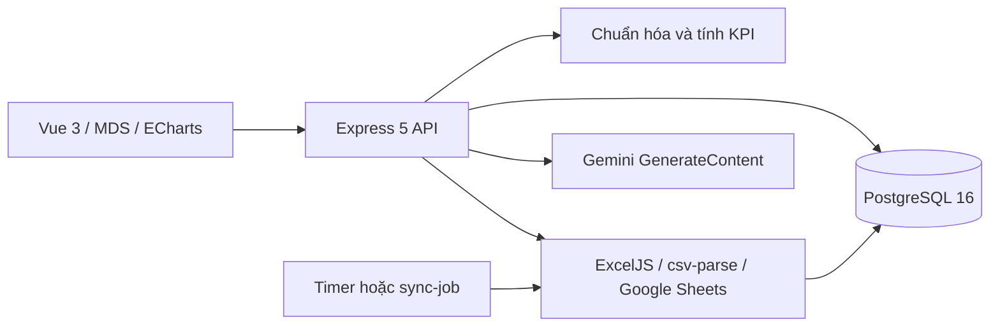

# 02 — Công nghệ và kiến trúc

Nguồn phiên bản chính xác: `package-lock.json`; Node image trong `Dockerfile`.

| Thành phần | Phiên bản | Công dụng |
|---|---|---|
| Node.js | 24, bookworm-slim | Runtime Docker, ES modules |
| Express | 5.1.0 | HTTP API và static UI |
| PostgreSQL / pg | 16.4 / 8.16.3 | DB, pool tối đa 10 kết nối mỗi process |
| Zod | 4.1.12 | Kiểm tra request và phản hồi AI |
| ExcelJS / csv-parse | 4.4.0 / 7.0.3 | Đọc file |
| google-auth-library | 10.3.0 | ADC và Google API |
| multer | 2.4.0 | Upload vào RAM |
| helmet / express-rate-limit | 8.1.0 / 8.7.1 | Headers và giới hạn request |
| Vue / Vite / Tailwind / ECharts / html2canvas | Theo package-lock.json | MDS UI build + biểu đồ + PNG |

`uuid=11.1.1` là override cho dependency lồng; đọc XLSX đã được kiểm tra sau thay đổi. Mật khẩu dùng `node:crypto` scrypt, không dùng bcrypt/JWT.

## Module thực tế

| File | Trách nhiệm |
|---|---|
| `server/index.js` | Middleware, schemas request, routes, lifecycle và timer |
| `server/auth.js` | Hash mật khẩu, session, authorize, bootstrap |
| `server/db.js` | Pool, transaction, migrate v1–v3, audit |
| `server/domain.js` | Mapping mặc định, chuẩn hóa, ngày UTC+7, KPI |
| `server/ingestion.js` | File/Sheet/AI, staging input, snapshot, đồng bộ |
| `server/sync-job.js` | Entrypoint chạy syncAll một lượt |
| `server/source-dimensions.js` | Nhận diện bằng quy tắc, validate, nhóm/lọc nguồn |
| `server/report-export.js` | Workbook Excel báo cáo theo filter |
| `server/event-slug.js` | Tạo slug ổn định, kiểm tra trùng |
| `frontend/`, `dist/` | Source Vue 3 + MDS copy-in; Vite build, Docker multi-stage |

Docker là yêu cầu trực tiếp. PostgreSQL/Node là lựa chọn của bản triển khai ban đầu; UI hiện là Vue 3/MDS; không có bằng chứng chủ dự án yêu cầu riêng PostgreSQL thay MySQL. Giữ DB/Node hiện có khi chuyển UI. Mô hình snapshot JSONB cho phép xem lịch sử nhưng mỗi báo cáo đọc toàn bộ snapshot vào RAM; chưa thiết kế cho hàng triệu dòng.

File upload chỉ nằm trong RAM trong request; payload staging và snapshot lưu DB. Excel xuất trong RAM, gửi binary cho trình duyệt. Không có bucket lưu file gốc. Static chính là `dist/` (bundle Vite); deep link hợp lệ fallback index.html. Key Google nằm ngoài source, mount read-only lúc chạy. Model được gọi trực tiếp; chưa có managed Agent Runtime triển khai riêng.
